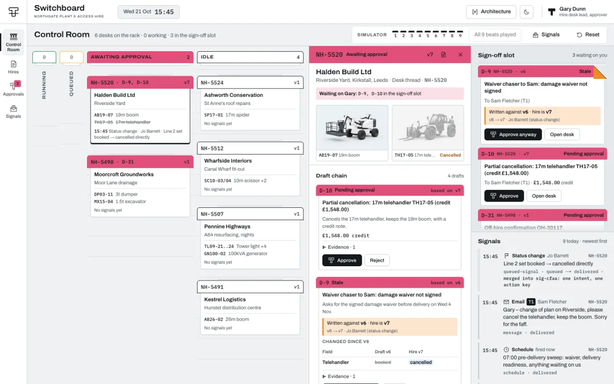
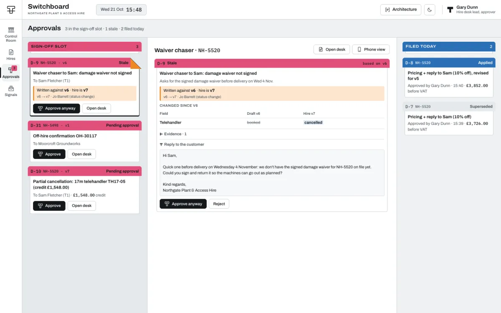

# Switchboard

Switchboard is a control room for people and agents managing hire bookings, built with Next.js, TypeScript and Mastra.

A customer asks for a discount. Someone changes the booking. An approval arrives for the earlier version.

Switchboard makes that overlap visible. It gives each hire a desk where customer emails, staff notes, booking changes and approvals stay connected. An agent can handle routine work; people decide on changes to money, dates and cancellations.

[Try the demo](https://switchboard.davidmansaray.com)

Northgate Plant & Access Hire is a sample business created for the demo. The default model is scripted, replay recordings come from that model, and email stays in a simulated in-app outbox. The role picker is demo authentication.



## A desk for each hire

A booking is more than its latest fields. There may be an unanswered request, a note from a call and a draft waiting for approval. The desk keeps those open loops alongside the current hire, with the source events and draft history available to inspect.

The Control Room shows which desks are working, which have queued changes and which need a person. A PO number or invoice address can be applied and logged automatically. Discounts, pricing, dates, duration and cancellations need approval; unrecognised fields cannot be applied automatically.

## Approval belongs to a version

A draft can be sensible when it is written and wrong by the time someone approves it. When the hire changes, Switchboard marks the draft stale and shows the difference. The desk regenerates it against the current booking and returns it for review.

The decision stays attached to the evidence and the version it concerns. An old approval cannot quietly become permission for a different change.



## Follow the difficult moments

Use **Next beat** in the demo's Simulator to walk through the story:

1. A customer asks for a discount while a PO arrives on another email thread. Watch routine work complete and the unanswered request stay open.
2. A staff edit changes the hire while a draft is being prepared. Inspect the stale draft, version difference and replacement approval.
3. Approve the replacement and crash the worker after the pricing write. Follow recovery: the action ledger skips the repeated write and the story records one simulated outbox email.
4. Send a customer cancellation alongside a staff cancellation. Follow the two signals into one intent and one customer-facing draft. After approval, the action produces one credit note.

The [scenario and screen guide](docs/architecture.md#the-hero-story-9-beats) gives the full nine-beat walkthrough.

## What keeps the workflow safe

Next.js, TypeScript, PostgreSQL and Mastra support the desk. Version checks, approval records and an action ledger protect application writes when work is retried or a worker recovers. The same story runs against Mastra's harness and an application-owned signal loop.

The [architecture guide](docs/architecture.md#architecture) explains those choices, signal delivery, schedules, model modes and evaluations. The UI's Architecture Overlay connects them to the screens.

A live-provider path exists, but the offline story does not establish live model quality. This build assumes one agent replica and includes process-local queues; it needs further authentication, delivery and operational work for production use. See [deployment boundaries](docs/deployment.md) and [fixture provenance](scenarios/README.md).

## Run it locally

Requirements: Node ≥ 22.13, pnpm 10, PostgreSQL 17 with `vector`, `pg_trgm` and `pgcrypto`, plus `psql` (Homebrew is sufficient on macOS).

```bash
pnpm install --frozen-lockfile
pnpm setup:local                    # random secrets; scripted model; isolated demo controls
pnpm db:create                      # dedicated switchboard_showcase_* databases + extensions
pnpm db:reset                       # migrate + seed the morning before the story
pnpm dev                            # web http://localhost:3223 · agent http://localhost:4223
```

`pnpm setup:local` preserves an existing `.env.local`. The example itself leaves crash/reset off; the setup helper enables them for the dedicated local story. Database reset is destructive within that disposable database.

`pnpm dev` loads the repo-root `.env.local` into both services and supervises the agent process in the local demo: when the simulator's **Crash worker** really kills it, it comes back by itself.

Open http://localhost:3223 and use the **Simulator** rail in the Control Room: *Next beat* plays the hero story one beat at a time against the real harness and database, *Signals* sends free-form email / notes / edits / status changes, fires the 07:00 sweep or crashes the worker, and *Reset* goes back to the seeded morning. The same runner is on the command line:

```bash
pnpm scenario:state        # where the story is
pnpm scenario:beat         # next beat (or: pnpm scenario:beat 5, pnpm scenario:beat all)
pnpm scenario:reset        # back to the seeded morning
```

## Quality gates

```bash
pnpm lint && pnpm typecheck
pnpm test && pnpm test:app # unit + integration on each signal backend (switchboard_showcase_test)
pnpm eval                 # Mastra scorers over the whole story; no API key (scripted)
pnpm eval:app             # the same on SIGNAL_BACKEND=app
EVAL_REQUIRE_RECORDINGS=true pnpm eval:replay # require every model step from recordings
pnpm scenario:record      # record the story (RECORD_SOURCE=live|scripted) into scenarios/recordings
pnpm build                # next build + mastra build
pnpm e2e                  # Playwright: the hero story through the UI, on harness then app
```

See [verification results](docs/verification.md) for checks performed on this application snapshot. CI runs lint, types, deterministic tests/evaluations and builds without live provider credentials.

`pnpm e2e` starts the production builds on their own ports (web 3243, agent 4243) and database (`switchboard_showcase_e2e`) for each backend, under the same supervisor, and drives the installed Google Chrome (`channel: 'chrome'`; no Playwright browser download).

Simulator reset clears and reseeds its data in one database transaction, so concurrent refreshes cannot observe an empty scenario and a failed seed preserves the previous state. A database regression test injects a seed failure to verify rollback.

The E2E runner checks that its ports are free before resetting the disposable database, verifies the requested backend at startup, and waits for the previous stack to stop before starting the next. It saves per-backend stack logs and browser traces under `test-results/`; GitHub retains failure artifacts for seven days.

## Further reading

- [Architecture, scenario and screen guide](docs/architecture.md)
- [Verification results](docs/verification.md)
- [Deployment boundaries](docs/deployment.md), [snapshot provenance](docs/provenance.md) and [pinned Mastra versions](apps/agent/MASTRA_VERSIONS.md)

## Licence

The source had no declared licence. No new licence has been added to this repository.
