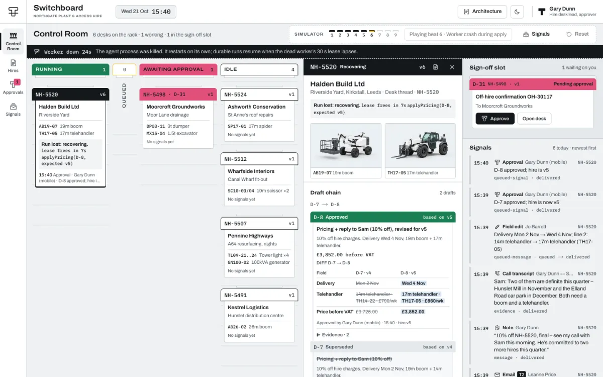
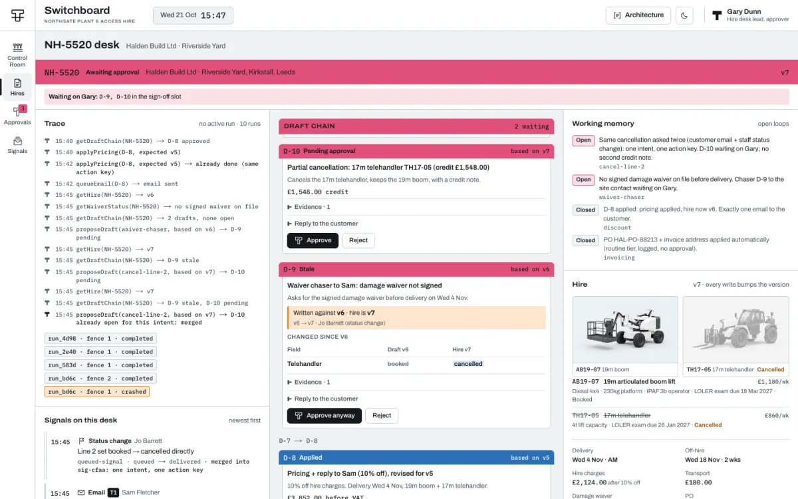
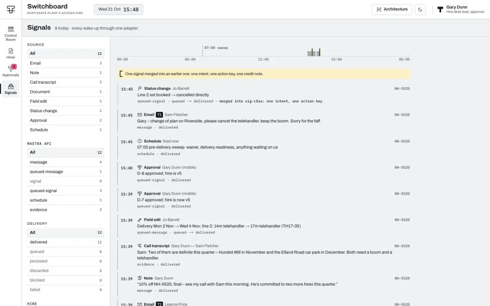

# Switchboard: architecture and scenario guide

[Back to the product overview](../README.md)

The Northgate story uses fictional data, a scripted model by default and a simulated in-app email outbox. The recordings exercise the workflow; they do not establish live-model quality.

## The hero story (9 beats)

| # | Beat | What to watch |
|---|---|---|
| 1 | Sam emails T1: "Can you knock something off?" | The idle NH-5520 card wakes (`sendMessage`), the desk records an **open loop** in working memory and drafts nothing. |
| 2 | Leanne sends the PO on T2 | Routine tier: PO + invoice address applied and logged, no approval. v3 → v4. |
| 3 | Gary's note "10% off, final, see my call" | The desk pulls the call transcript (evidence) and writes **D-7** against v4. |
| 4 | Jo moves delivery and swaps the telehandler *mid-run* | The edit waits in the card's **pocket** (`queueMessage`), the run is not interrupted, v5, D-7 folds **stale**. |
| 5 | Gary approves the stale draft from his phone | The approval is a signal. The desk sees v5, regenerates **D-8** (D-7 → D-8 with a field diff). |
| 6 | Gary approves D-8; the worker crashes mid-apply | The agent process is killed right after the pricing write. Recovery re-runs the tool call; the ledger skips it; **one simulated outbox email**. |
| 7 | 07:00 pre-delivery sweep (`mastra.schedules`) | No signed damage waiver on file: a chaser goes to the sign-off slot. |
| 8 | Sam emails "cancel the telehandler" and Jo cancels the line | One intent and one action key: one draft, then one credit note after approval; the second signal is shown **merged**. |
| 9 | Architecture Overlay | Every region labelled with the Mastra facility or app code behind it, plus "when not to use the harness". |

## Screens

- **Control Room** `/`: the rack (state columns Running · Queued · Awaiting approval · Idle; cards move with the *slot drop*), the desk drawer, the sign-off slot and the live signal stream.
- **Hire desk** `/hires/NH-5520`: the full-page desk (trace and signals · draft chain · working memory, hire, ledger, schedule).
- **Hires** `/hires`, **Approvals** `/approvals` (sign-off slot, selected chain, filed today), **Signals** `/signals` (filter rails, day strip, merged intents).
- **Mobile approval** `/m/approve/D-8`: one job, decide this draft (also shown in a phone frame on desktop for beats 5 and 6).
- **Sign in as** `/sign-in`: demo auth (signed cookie). Approvals are re-checked against the role on the server.

| | |
|---|---|
|  |  |
|  |  |

## Architecture

```
apps/web        Next.js: server components read Postgres; /api/stream = LISTEN/NOTIFY → SSE → router.refresh()
apps/agent      Mastra server: the durable desk agent, tools, the signal adapter, schedules, scenario runner
packages/db     Drizzle schema + SQL migrations (version triggers, staleness, NOTIFY), seed, queries
packages/core   Pure rules shared by both: wake rules, tiers, action keys, pricing, draft states, hero beats
```

### The harness stance

**Use Mastra's harness runtime so the app doesn't build its own queue, and put the hard guarantees in the tools, not in control flow.**

- One **durable agent** (`durable: true`, `recovery: { durableAgents: 'auto' }`) and **one long-lived thread per hire** (resource = customer). Two email conversations (T1 Sam, T2 Leanne) are tagged messages inside that one thread.
- Every wake-up goes through one adapter, `apps/agent/src/signals/adapter.ts` (wake rules, debounce, mirroring into `signals_log`). It is handed a backend:

| Trigger | Mastra call | Behaviour |
|---|---|---|
| Inbound email, `@assistant` note | `sendMessage` | starts a run if idle, joins it if running |
| Plain internal note | `sendSignal` (persist) | stored on the thread as context, wakes nobody |
| Staff field edit | app debounce (1.5 s) → `queueMessage` | never interrupts a run; processed next |
| Approval decided, line status change | `queueSignal` with system context | carries the draft, decision and new version |
| Daily 07:00 sweep | `mastra.schedules` bound to the thread | `ifActive: persist`, `ifIdle: wake` |

- `SIGNAL_BACKEND=app` swaps in an app-owned event loop (one serial queue per desk, `agent.generate()` per batch, croner for the cron). Same rendering, tools and guarantees; the whole test suite runs on both.
- **Guarantees live in the tools.** Business writes that depend on hire state take `expectedVersion` (a typed `STALE` result, not an exception). Action keys derived from the *intent*, never the run, make retried actions idempotent. `agent_actions (hire_id, action_key)` is unique, so a retried run, a recovered run and a second source for the same intent all collide. Customer-facing drafts must cite evidence, and `checkReply` refuses any price, date, weekday or percentage the hire doesn't support.
- **Approvals are events, not suspended steps.** A draft lives in `app.drafts` (`based_on_version`, `supersedes_id`); approving writes `app.approvals` and then signals the desk. Approving a stale draft never applies it: the desk regenerates (D-7 → D-8). An approved draft whose hire moves before it is applied is marked stale by the apply tool and regenerated too.

### The signals table

`app.signals_log` mirrors every delivery: `kind` (message / queued-message / signal / queued-signal / schedule), `outcome` (delivered / queued / persisted / discarded / blocked / failed), `run_id`, `waits_for_run_id` (the run a queued signal waited for), `merged_into` (a duplicate intent's first signal) and the rendered contents. The stream, the card pockets and the Signals page render from it; a queued signal shows as picked up once its source event (`app.events.run_id`) has been taken by a run.

### Runtime behaviour and what the UI shows

- **Workers must be running before schedules fire.** `mastra.schedules` only ticks inside a process that started workers (the Mastra server does; scripts and tests call `mastra.startWorkers()`). `schedules.run(id)` fires immediately; the scheduler ticks every 10 s.
- **Recovery waits about 30 s.** A killed worker's run keeps its lease (`EXECUTION_LEASE_TTL_MS`, 30 s, renewed every 10 s). Auto-recovery takes the run over once it lapses; the desk shows *Run lost: recovering · lease frees in 18s*.
- **Recovery re-runs the interrupted tool call.** The step that was in flight runs again in the new process, which is why each retried business action is idempotent by action key: the trace shows `applyPricing(D-8) → already done (same action key)` and one simulated outbox email.
- **Queued messages are held in memory only.** The `queueMessage` FIFO is process-local (`EventEmitterPubSub`). Switchboard keeps every source event in `app.events` until a run handles it and re-sends unprocessed ones after a restart.
- **Fencing covers Mastra's writes, not ours.** A superseded run's own writes (messages, snapshots, working memory) are rejected by Mastra (`RunFenceConflictError`); app-side writes are protected by the ledger. The app backend has no Mastra fencing; it holds a Postgres session advisory lock per desk for each turn (released by Postgres if the process dies), plus the same ledger.

### Mastra facilities vs app code

| Mastra | Application code |
|---|---|
| Durable agent per hire thread; recovery and run fencing | Signal adapter + debounce (one file) and the `app` fallback loop |
| `sendMessage` / `queueMessage` / `sendSignal` / `queueSignal` | `app.drafts` (`based_on`, `supersedes`), `app.approvals`, approval tiers |
| `mastra.schedules` (07:00 sweep per desk) | Versioned rows: triggers bump the version, snapshot, diff, mark drafts stale |
| Working memory (open loops) + thread-scoped observational memory (live mode) | Action ledger + idempotency keys, outbox, credit notes |
| Tools with preconditions (`createTool`), scorers (`createScorer`) | The UI, SSE, the scenario runner and simulator |

The **Architecture Overlay** (top bar, or beat 9) shows this on the live screens. Its second tab lists where this build deliberately does *not* use the harness: long approvals (AgentController approvals don't survive restarts), routine CRUD, the pinned beta APIs behind one adapter, and exactly-once in the tools.

### Models: scripted, live, record, replay

- `LLM_MODE=scripted` (default): a deterministic `LanguageModelV2` desk policy that reads the same signals and tool results a live model would and calls the same tools, so every guarantee is exercised with no key.
- `LLM_MODE=live`: `AGENT_MODEL` through Mastra's model router (`anthropic/claude-sonnet-5-5`). If the key is **not workspace-scoped**, set `ANTHROPIC_WORKSPACE_ID`: the router builds the AI SDK provider (`createAnthropic({ headers })`) with `anthropic-workspace-id` on every request (unit-tested at the wire).
- `LLM_MODE=record`: wraps the scripted desk by default (or the live model with `RECORD_SOURCE=live`) and writes every response to `scenarios/recordings/<hash>.json`. `pnpm scenario:record` plays the whole story to record it.
- `LLM_MODE=replay`: serves recordings, falling back to the scripted desk on a miss (counted and logged). Ids differ between the recording run and the replay run, so each recording stores the ids in prompt order and replay rewrites them in the recorded tool calls. Demos and evals stay offline.

`scenarios/recordings/` combines **scripted** CLI-story and eval-driver recordings. The strict replay check serves every model step from those recordings with zero misses; see [verification](verification.md). For live recording, set `RECORD_SOURCE=live` and a separate `RECORDINGS_DIR`; review provider-session content before publishing it.

### Evals

`pnpm eval` plays the story and scores every customer-facing draft with code-based Mastra scorers (`apps/agent/src/evals/scorers.ts`): **cites-evidence**, **no-unsupported-facts**, **links-open-request** and **reply-addressed** must all be 1.0; it also checks one email per draft, one credit note per cancelled line and that no stale draft was applied.

---

## Deploying

See [deployment boundaries](deployment.md), [snapshot provenance](provenance.md), and [pinned Mastra versions](../apps/agent/MASTRA_VERSIONS.md). The original server wiring, brief and build history are excluded.

